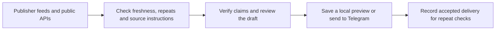

# Hermes AI briefing

This folder contains the local Hermes implementation of the daily AI briefing. The collector uses publisher RSS for AI and fintech discovery, the arXiv API for papers, and GitHub's API for repository metadata and README evidence.

The service separates publisher feed summaries from original article evidence. It records the outcome before sending and requires a matching Telegram receipt before marking stories delivered. An uncertain send requires reconciliation before retry.

## Local setup

This implementation expects an existing Hermes profile named `briefing`, its three configured model stage jobs, and the managed Hermes runtime. Copy this directory as a subdirectory under the profile's `scripts` directory. Use `brief_feed_preview.py` as the local preview entry. Preview mode writes evidence under `cron/briefing-v3-preview`.

For scheduled Telegram delivery, configure `HERMES_BRIEF_TELEGRAM_CHAT_ID` as an approved numeric destination in the local worker environment. Hermes supplies the bot credentials through its existing default profile. Verify the route locally before pointing the briefing job at `activation_entry.py`. The deployment uses `0 7 * * *` with the scheduler on India Standard Time.

Use the existing Hermes job in script mode, with cron output set to local. The production entry sends the digest internally and keeps its receipts under the local profile. Switching back to `brief_feed_preview.py` restores local preview mode.

## Verification

Run `python -B -m unittest discover` from this folder. The included tests use synthetic inputs and fake transports. [Activation dashboard](DASHBOARD.md)
